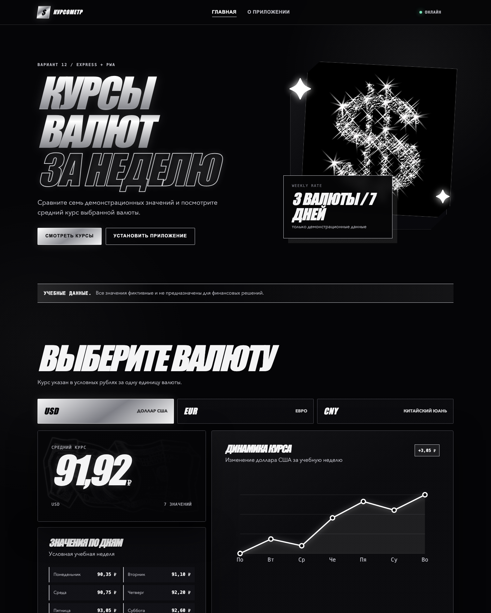
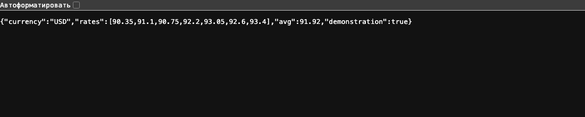

# Лабораторная работа №6. Node.js, Express и PWA

## Как запустить сайт

Открыть терминал в папке проекта и установить зависимости:

```bash
npm install
```

Запустить сервер:

```bash
npm start
```

После запуска открыть в браузере адрес:

```text
http://localhost:3000
```

Страница «О приложении» доступна по адресу:

```text
http://localhost:3000/about
```

Для остановки сервера нажать `Ctrl + C` в терминале.

## Краткое содержание файлов

| Файл | Что находится в файле |
| --- | --- |
| `package.json` | Название проекта, зависимость Express и команды `npm start` и `npm run icons`. |
| `package-lock.json` | Точные версии установленных npm-пакетов. |
| `server.js` | Express-сервер, данные USD, EUR и CNY, вычисление среднего курса и API-маршруты. |
| `public/index.html` | Главная страница с выбором валюты, недельными значениями и графиком. |
| `public/about.html` | Страница с кратким описанием приложения. |
| `public/style.css` | Оформление сайта и адаптация интерфейса под разные размеры экрана. |
| `public/script.js` | Запросы к API, переключение валют, обновление DOM, SVG-график и регистрация Service Worker. |
| `public/manifest.json` | Название, цвета, режим отображения и иконки устанавливаемого PWA. |
| `public/service-worker.js` | Кеширование страниц, ресурсов и ответов API для офлайн-работы. |
| `public/assets/` | Тематические изображения, используемые в оформлении страниц. |
| `public/icons/` | PNG-иконки приложения размером 192×192 и 512×512 пикселей. |
| `scripts/create-icons.js` | Локальное создание PNG-иконок средствами Node.js. |
| `docs/images/` | Скриншоты готового приложения, приведённые в README. |

## Ход работы

1. Создан Node.js-проект и настроен файл `package.json`.
2. Через npm установлен фреймворк Express.
3. В `server.js` добавлены демонстрационные курсы USD, EUR и CNY за семь дней.
4. Создана функция `calculateAverage()`, которая программно рассчитывает средний курс.
5. Реализованы маршруты `/`, `/about`, `/api/status` и `/api/rates/:currency`.
6. Добавлена обработка неподдерживаемой валюты с HTTP-статусом `404`.
7. Созданы главная страница, страница «О приложении» и адаптивное оформление.
8. В клиентском JavaScript реализовано получение данных через `fetch()` без перезагрузки страницы.
9. Добавлено динамическое отображение семи значений, среднего курса и SVG-графика.
10. Подключены Web App Manifest и Service Worker для установки приложения и офлайн-работы.
11. Проверена работа маршрутов, API, кнопок выбора валюты и кеширования данных.

## Что реализовано в JavaScript

### Серверный JavaScript — `server.js`

- запуск Express-сервера на порту 3000;
- раздача файлов из папки `public` через `express.static()`;
- хранение семи демонстрационных значений для USD, EUR и CNY;
- программный расчёт среднего курса функцией `calculateAverage()`;
- выдача главной страницы по маршруту `/`;
- выдача страницы «О приложении» по маршруту `/about`;
- возврат состояния сервера в JSON по маршруту `/api/status`;
- получение валюты из адреса через `req.params.currency`;
- возврат курса, массива значений и среднего результата в формате JSON;
- возврат ошибки и статуса `404` для неподдерживаемой валюты.

### Клиентский JavaScript — `public/script.js`

- обработка нажатий на кнопки USD, EUR и CNY;
- отправка запроса к серверу с помощью `fetch()`;
- получение и обработка JSON-ответа;
- обновление содержимого страницы через DOM без перезагрузки;
- вывод курсов за семь дней недели;
- отображение среднего курса и изменения за неделю;
- построение SVG-графика без сторонних библиотек;
- вывод сообщения при ошибке загрузки;
- отображение состояния «Онлайн» или «Офлайн»;
- регистрация Service Worker;
- поддержка кнопки установки PWA в совместимом браузере.

### Service Worker — `public/service-worker.js`

- кеширование HTML, CSS, JavaScript, изображений, иконок и манифеста;
- предварительное сохранение ответов API для USD, EUR и CNY;
- загрузка статических файлов из кеша;
- попытка получить свежие данные API из сети с переходом на кеш без интернета;
- удаление старых версий кеша после обновления приложения.

## Скриншоты результата

### Главная страница

На странице можно выбрать валюту, увидеть средний курс, значения за семь дней и график изменения курса.



### Страница «О приложении»

Маршрут `/about` открывает отдельную HTML-страницу с описанием приложения.


### Результат работы API

Маршрут `/api/rates/USD` возвращает JSON с кодом валюты, семью значениями и программно рассчитанным средним курсом.



## Итоговый результат и вывод

В результате создано работающее клиент-серверное приложение «Курсы валют за неделю». Express-сервер отдаёт HTML-страницы и JSON API, а пользователь может переключать USD, EUR и CNY без перезагрузки страницы. Для выбранной валюты отображаются семь демонстрационных значений, средний курс и SVG-график. Неподдерживаемая валюта обрабатывается ответом со статусом `404`.

В ходе лабораторной работы я научилась запускать JavaScript на стороне сервера с помощью Node.js, устанавливать зависимости через npm и создавать маршруты Express. Я реализовала JSON API, получила параметр валюты из URL, применила `fetch()` и DOM для динамического изменения страницы. Также я подключила Web App Manifest, Service Worker и Cache API, благодаря которым приложение можно установить в поддерживаемом браузере и открыть без подключения к интернету после первоначальной загрузки.
